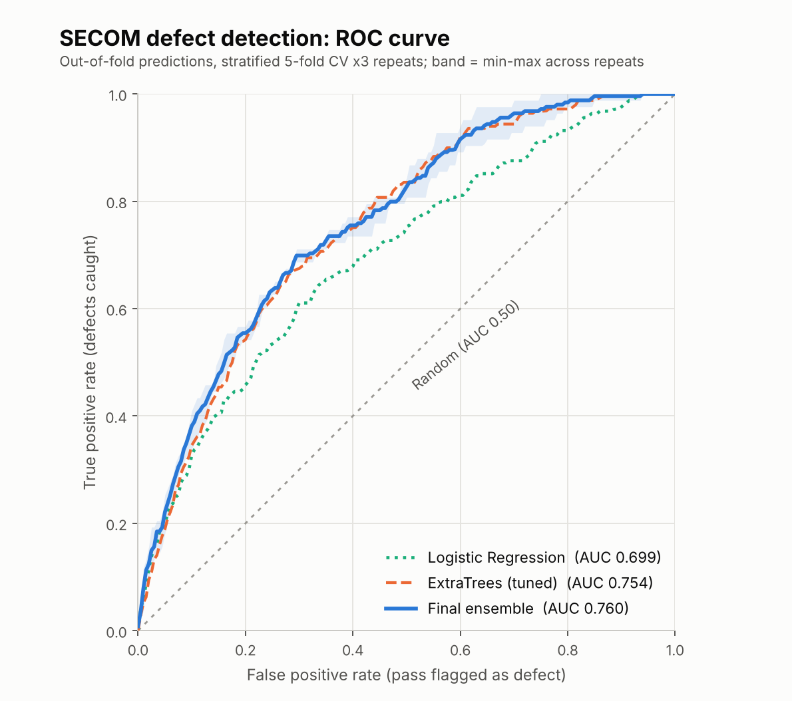

# SECOM Defect Detection

Predicting defective wafers from 590 sensor readings in a semiconductor manufacturing process (Kaggle competition, evaluated by ROC-AUC).

**Result:** mean cross-validated ROC-AUC of **~0.75** (0.760 pooled out-of-fold), up from a 0.69 baseline. Kaggle leaderboard: **6th place**.
<!-- TODO: add a leaderboard screenshot, e.g. reports/figures/leaderboard.png -->



## The problem

| | |
|---|---|
| Samples | 1,253 train / 314 test |
| Features | 590 sensors (+ timestamp) |
| Target | 1 = fail (defective), -1 = pass (relabelled to 1/0 in code) |
| Class balance | 83 defects, **6.62%** |
| Data quality | 116 constant columns, 506 columns with missing values, 24 with >50% missing |

Two things shape every decision below: the classes are heavily imbalanced, and with only 83 defects any single validation split is very noisy (fold-to-fold std of AUC is about 0.05).

## Approach

1. **Cleaning:** drop constant columns and columns with more than 50% missing values (590 -> 451 features, including a day-of-year time feature).
2. **Leakage-safe preprocessing:** median imputation (and scaling for the linear model) lives inside a scikit-learn `Pipeline`, so it is re-fitted on each training fold only.
3. **Validation:** repeated stratified 5-fold CV. ROC-AUC is threshold-free, which fits the competition metric; stratification keeps the 6.6% defect rate in every fold.
4. **Models compared:** Logistic Regression, Random Forest, ExtraTrees, LightGBM.
5. **Final model:** rank-averaged ensemble of tuned ExtraTrees (weight 2), ExtraTrees, Random Forest and Logistic Regression. Ranks are used so models with different score scales can be averaged.

### Cross-validation results (mean per-fold ROC-AUC)

| Model | AUC |
|---|---|
| Logistic Regression | 0.69 |
| LightGBM | 0.69 |
| Random Forest | 0.73 |
| ExtraTrees (tuned) | 0.74 |
| **Final ensemble** | **0.75** |

### What did not help

Each idea below was tested with CV (feature selection was done *inside* each fold to avoid optimistic bias) and rejected.

| Idea | AUC | vs. ExtraTrees reference (0.739) |
|---|---|---|
| Isolation Forest anomaly score as a feature | 0.734 | no gain |
| Isolation Forest score alone | 0.547 | near random: defects are not simple outliers |
| Missing-value count per row | 0.728 | no gain |
| Univariate selection (top 20 / 40 / 80 features) | 0.663 / 0.685 / 0.709 | worse |
| Importance-based selection (top 30 / 60 / 100 / 150 features) | 0.709 / 0.725 / 0.735 / 0.737 | no better than using all 451 |
| Time feature only | 0.575 | weak signal |

Takeaway: the signal is spread thinly across many sensors, so removing features throws information away, and tree ensembles are already robust to noisy columns.

## Limitations

- With 83 defects the CV estimate carries roughly +/-0.05 uncertainty; differences of ~0.01 between models are within noise.
- Feature importances are unstable at this sample size, so they should be read as "sensors worth inspecting", not as root causes.
- Hyperparameters were tuned with random search on one set of CV splits and re-checked on fresh splits; the tuned gain over defaults is small.

## Reproduce

```bash
git clone <this-repo-url>
cd secom-defect-detection
pip install -r requirements.txt
# put train.csv and test.csv in data/ (see data/README.md)
python src/train.py            # full run, a few minutes
python src/train.py --quick    # fast smoke test
```

Outputs: `reports/figures/roc_curve.png` and `outputs/submission.csv` (higher score = higher defect risk).

## Repo layout

```
src/train.py          cleaning, CV, ROC plot, final fit and submission
reports/figures/      ROC curve
data/                 place the Kaggle CSVs here (not tracked)
notebooks/            exploratory analysis (optional)
```
